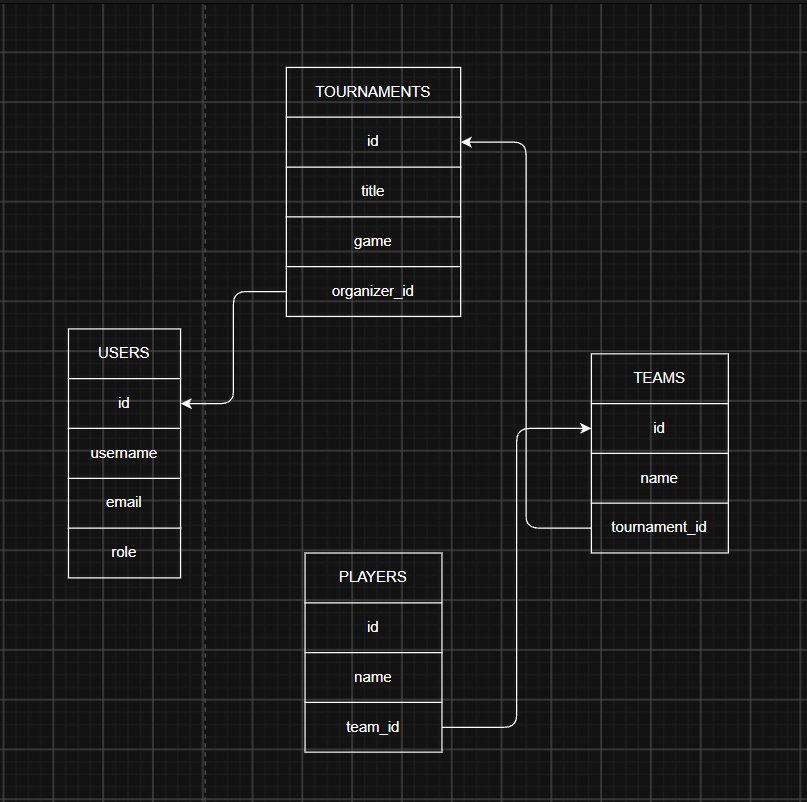

# Tournament Tracker API

## Опис ідеї
**Tournament Tracker** - це платформа для створення, управління та відстеження студентських кіберспортивних турнірів. Сайт дозволяє організаторам створювати турніри, реєструвати команди та гравців, керувати розкладом матчів і оновлювати турнірні сітки та результати ігор. Користувачі можуть переглядати актуальні матчі, склади команд і статистику.

## Архітектура REST API

### Турніри

- **Отримати список усіх турнірів**
  * **Method:** GET
  * **Response Status:** 200 OK
  * **Response Body:**
    ```json
    [
      {
        "id": 1,
        "title": "Cyber Championship",
        "game": "Dota 2",
        "status": "registration",
        "organizer_id": 1,
        "teams": []
      }
    ]
    ```

- **Отримати конкретний турнір за ID**
  * **Method:** GET
  * **Response Status:** 200 OK
  * **Response Body:**
    ```json
    {
      "id": 1,
      "title": "Cyber Championship",
      "game": "Dota 2",
      "status": "registration",
      "organizer_id": 1,
      "teams": []
    }
    ```

- **Створити новий турнір**
  * **Method:** POST
  * **Request Body:**
    ```json
    {
      "title": "Cyber Championship",
      "game": "Dota 2",
      "status": "registration",
      "organizer_id": 1
    }
    ```
  * **Response Status:** 201 Created

- **Повністю оновити турнір**
  * **Method:** PUT
  * **Request Body:**
    ```json
    {
      "title": "Updated Championship Name",
      "game": "Dota 2",
      "status": "ongoing",
      "organizer_id": 1
    }
    ```
  * **Response Status:** 200 OK

- **Частково оновити турнір**
  * **Method:** PATCH
  * **Request Body:**
    ```json
    {
      "status": "ongoing"
    }
    ```
  * **Response Status:** 200 OK

- **Видалити турнір (Помилка: якщо є команди)**
  * **Method:** DELETE
  * **Response Status:** 400 Bad Request
  * **Response Body:**
    ```json
    {
      "error": "Неможливо видалити турнір 'Cyber Championship', оскільки до нього прив'язано команд: 1."
    }
    ```

- **Успішно видалити турнір**
  * **Method:** DELETE
  * **Response Status:** 204 No Content (або 200 OK)


### Команди

- **Отримати список команд**
  * **Method:** GET
  * **Response Status:** 200 OK
  * **Response Body:**
    ```json
    [
      {
        "id": 2,
        "name": "Team Spirit",
        "tournament": 1,
        "players": []
      }
    ]
    ```

- **Отримати конкретну команду за ID**
  * **Method:** GET
  * **Response Status:** 200 OK
  * **Response Body:**
    ```json
    {
      "id": 2,
      "name": "Team Spirit",
      "tournament": 1,
      "players": []
    }
    ```

- **Зареєструвати нову команду**
  * **Method:** POST
  * **Request Body:**
    ```json
    {
      "name": "Team Spirit",
      "tournament": 1
    }
    ```
  * **Response Status:** 201 Created

- **Видалити команду (Помилка: якщо є гравці)**
  * **Method:** DELETE
  * **Response Status:** 400 Bad Request
  * **Response Body:**
    ```json
    {
      "error": "Неможливо видалити команду 'Team Spirit', оскільки в ній зареєстровано гравців: 1."
    }
    ```

- **Успішно видалити команду**
  * **Method:** DELETE
  * **Response Status:** 204 No Content (або 200 OK)


### Гравці

- **Отримати список гравців**
  * **Method:** GET
  * **Response Status:** 200 OK
  * **Response Body:**
    ```json
    [
      {
        "id": 1,
        "nickname": "Yatoro",
        "role": "Carry",
        "team": 2
      }
    ]
    ```

- **Отримати конкретного гравця за ID**
  * **Method:** GET
  * **Response Status:** 200 OK
  * **Response Body:**
    ```json
    {
      "id": 1,
      "nickname": "Yatoro",
      "role": "Carry",
      "team": 2
    }
    ```

- **Створити нового гравця**
  * **Method:** POST
  * **Request Body:**
    ```json
    {
      "nickname": "Yatoro",
      "role": "Carry",
      "team": 2
    }
    ```
  * **Response Status:** 201 Created

## Схема бази даних


## Як запустити проєкт

1. Клонуйте репозиторій:
```bash
git clone https://github.com/burdeynainnaa/rest.api
cd rest.api
```
2. Створіть та активуйте віртуальне середовище:
```bash
python -m venv venv
source venv\Scripts\activate
```
3. Встановіть залежності:
```bash
pip install -r requirements.txt
```
4. Застосуйте міграції бази даних:
```bash
python manage.py makemigrations
python manage.py migrate
```
5. Запустіть локальний сервер:
```bash
python manage.py runserver
```